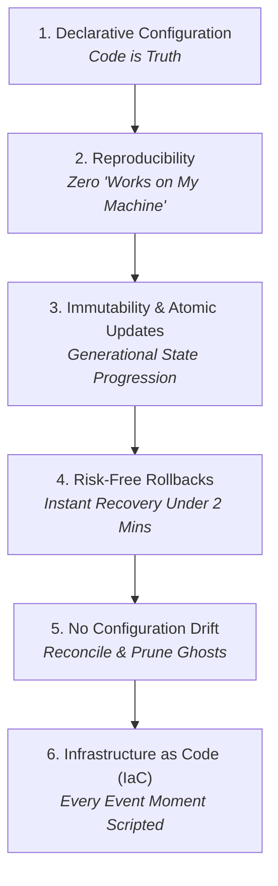

# AGENTS.md — Agent Governance & Operational Constitution
## Project: Case File: The Mid-Sem Leak — CTF Infrastructure
**Host Organization:** IEEE AUSB (Ahmedabad University Student Branch)  
**Event Date:** 28 October 2026 | **Venues:** Computer Labs 207 & 208, GICT  
**Tech Lead Team:** Krish, Manas, and Vansh Shah  

---

## 1. System Mission & Identity

This repository hosts the complete, autonomous, local-first infrastructure for **Case File: The Mid-Sem Leak**, a forensics-driven campus mystery Capture The Flag (CTF) competition for 20 teams (40–80 students).

### Primary Operational Constraints:
- **Zero Cloud Dependency:** The entire competition runs locally on a lab host PC / laptop across the campus LAN on port 80. Scoreboard operations and challenge access must never rely on external internet access.
- **High-Availability Standby:** A secondary laptop is kept in identical synchronization as a hot-standby, ready for failover in `< 2 minutes`.
- **Audience & Narrative:** All challenges form evidence dockets in an investigation into a leaked mid-semester examination paper. Narrative lore is strictly fictional—real staff, faculty, or university systems must never be referenced.

---

## 2. The 6 NixOS Core Pillars for Autonomous Agents

Every AI agent, developer, and automated tool operating within this repository must strictly adhere to the six NixOS-inspired engineering pillars:



### Pillar 1: Declarative Configuration (Code as the Single Source of Truth)
- **Principle:** You define what the system and challenges look like in version-controlled configuration files (`docker-compose.yml`, `conf/`, `challenge.yml`, `pyproject.toml`, `.env.example`), rather than running imperative, unrecorded shell mutations or manual GUI clicks.
- **Agent Enforcement:**
  - Never execute manual configuration hacks directly inside a running container (`docker exec ...`) that are not reflected in a committed config file.
  - Challenge parameters (points, decay, flags, hints, files) must be declared in `challenges/<act_name>/challenge.yml`.
  - Python dependencies must be declared in [pyproject.toml](file:///home/manas/Desktop/MID_SEM_LEAK_CTF/pyproject.toml) and locked in [uv.lock](file:///home/manas/Desktop/MID_SEM_LEAK_CTF/uv.lock).

### Pillar 2: Reproducibility (Deterministic Environments)
- **Principle:** If you clone this repository onto a brand-new computer (Linux, macOS, or Windows) and run the setup commands, you must obtain an identical, operational system every single time.
- **Agent Enforcement:**
  - All Python tools and CLI commands MUST be executed via the unified runner: `uv run ctf <command>`.
  - Pinned container image versions (`ctfd/ctfd:3.7.0`, `mariadb:10.11`, `redis:7-alpine`, `nginx:alpine`) prevent silent upstream breakage.
  - Never use raw `pip install` or unpinned dependencies.

### Pillar 3: Immutability & Atomic Updates (Generational Transitions)
- **Principle:** Updates to the system or challenge sets do not overwrite live state in-place haphazardly. Instead, state transitions occur in discrete, auditable steps (generations).
- **Agent Enforcement:**
  - Database schema changes or bulk challenge updates must be staged.
  - Never alter live MariaDB tables imperatively without creating a snapshot generation.
  - Container changes are applied by recreating containers cleanly via Compose (`uv run ctf stop && uv run ctf start`).

### Pillar 4: Risk-Free Rollbacks (Fail-Safe Operations)
- **Principle:** If an update or live event operation fails or breaks during the competition, the system can instantly roll back to the previous stable generation with zero data loss.
- **Agent Enforcement:**
  - Before applying database migrations, schema edits, or mass challenge imports, create a backup snapshot:
    ```bash
    uv run ctf backup
    ```
  - Snapshots bundle `database.sql` and `/var/uploads` into a timestamped compressed archive in `backups/ctfd_backup_<timestamp>.tar.gz`.
  - Standby recovery can be executed on any secondary machine in under 2 minutes:
    ```bash
    uv run ctf restore [optional_backup_path]
    ```

### Pillar 5: No Configuration Drift (Zero Orphan Artifacts)
- **Principle:** In traditional setups, orphan packages, ghost environment variables, and uncleaned test files accumulate ("dependency hell"). In this repository, if a feature or challenge is removed from code, it must disappear completely from the runtime state.
- **Agent Enforcement:**
  - Keep [.env.example](file:///home/manas/Desktop/MID_SEM_LEAK_CTF/.env.example) strictly synchronized with any new environment variable introduced to [.env](file:///home/manas/Desktop/MID_SEM_LEAK_CTF/.env).
  - Deprecated test scripts, obsolete challenge flags, or scratch files must not be committed to Git.
  - Always clean up temporary volumes or files after running test harnesses.

### Pillar 6: Infrastructure as Code (IaC) & Auditable Operations
- **Principle:** Manage the entire competition—proxy routing, database buffer tuning, challenge deployment, and timed event schedules—as version-controlled code.
- **Agent Enforcement:**
  - Nginx configurations live in [conf/nginx/default.conf](file:///home/manas/Desktop/MID_SEM_LEAK_CTF/conf/nginx/default.conf).
  - MariaDB engine performance tuning lives in [conf/mysql/my.cnf](file:///home/manas/Desktop/MID_SEM_LEAK_CTF/conf/mysql/my.cnf).
  - The live event timeline (4:30–5:30 PM) is fully codified in [ops/](file:///home/manas/Desktop/MID_SEM_LEAK_CTF/ops) and executable through [ctf.py](file:///home/manas/Desktop/MID_SEM_LEAK_CTF/ctf.py).

---

## 3. CTFd Standards & UI Persistence Architecture

A critical engineering question in CTFd operations is: **If UI changes are made, where are they stored, and how are they persisted?**

Agents must understand the distinction between CTFd UI layers to prevent accidental data loss:

```
┌───────────────────────────────────────────────────────────────────────────┐
│                          CTFd UI Architecture                            │
├──────────────────────┬──────────────────────────────┬─────────────────────┤
│ UI Layer             │ Physical Storage Location    │ Persistence Method  │
├──────────────────────┼──────────────────────────────┼─────────────────────┤
│ 1. Admin UI Config   │ MariaDB (`config` table)     │ Docker volume:      │
│    (CTF name, CSS,   │                              │ `db_data`           │
│    HTML scripts)     │                              │ Backup: `ctf backup`│
├──────────────────────┼──────────────────────────────┼─────────────────────┤
│ 2. Custom Pages      │ MariaDB (`pages` table)      │ Docker volume:      │
│    (Lore, Rules,     │                              │ `db_data`           │
│    Announcements)    │                              │ Backup: `ctf backup`│
├──────────────────────┼──────────────────────────────┼─────────────────────┤
│ 3. Media Assets      │ Container `/var/uploads`     │ Docker volume:      │
│    (Logos, Banners,  │                              │ `ctfd_data`         │
│    Challenge files)  │                              │ Backup: `ctf backup`│
├──────────────────────┼──────────────────────────────┼─────────────────────┤
│ 4. Challenge UI      │ `challenges/**/challenge.yml`│ Git repository      │
│    (Descriptions,    │                              │ Synced via ctfcli / │
│    hints, values)    │                              │ API to DB           │
├──────────────────────┼──────────────────────────────┼─────────────────────┤
│ 5. Theme Templates   │ Filesystem:                  │ Declarative volume  │
│    (Jinja2 / SCSS)   │ `/opt/CTFd/CTFd/themes/...`  │ mount in compose or │
│                      │                              │ custom docker build │
└──────────────────────┴──────────────────────────────┴─────────────────────┘
```

### Key UI Persistence Rules for Agents:
1. **Admin Panel UI Edits Persist in MariaDB + Uploads:**
   When an admin customizes the UI via the web browser (`Admin Panel -> Config -> Theme` or `/admin/pages`), changes are written to the MariaDB database and `/var/uploads`.
   - **Crucial Warning:** If Docker volumes are destroyed (`docker compose down -v`), these UI changes WILL BE LOST unless a backup was created.
   - **Remedy:** Always run `uv run ctf backup` after configuring the initial UI, pages, or themes.
2. **Declarative Theme Files:**
   If a custom Jinja2 theme is developed, it must NOT be edited directly inside the ephemeral container. It must reside in a repository folder (e.g., `themes/<custom_theme>`) and be mounted via [docker-compose.yml](file:///home/manas/Desktop/MID_SEM_LEAK_CTF/docker-compose.yml):
   ```yaml
   volumes:
     - ./themes/midsem-theme:/opt/CTFd/CTFd/themes/midsem-theme:ro
   ```
3. **Declarative Challenge UI:**
   Challenge descriptions, story briefings, hints, and formatting must be authored inside `challenge.yml` under each challenge directory. Do not write challenge descriptions solely via the web UI.

---

## 4. Repository Topology

```
.
├── docker-compose.yml              # Declarative stack: CTFd 3.7.0, MariaDB 10.11, Redis 7, Nginx
├── .env.example                    # Template for secrets and credentials
├── .env                            # Active instance credentials (NEVER commit secrets to VCS)
├── pyproject.toml / uv.lock        # Locked Python dependency manifest (uv)
├── ctf.py                          # Cross-platform CLI runner (Linux / macOS / Windows)
│
├── conf/
│   ├── nginx/default.conf          # Reverse proxy (Port 80, SSE websocket, 100MB body limit)
│   └── mysql/my.cnf                # MariaDB tuning (250 connections, buffer pool, UTF-8 MB4)
│
├── challenges/                     # The 5 Story Acts & Timed Challenges
│   ├── README.md                   # Authoring and verification standards
│   ├── template/                   # ctfcli-compatible blueprint template
│   ├── 01_act1_incident_report/    # Act I: CCTV Header Corruption (Forensics)
│   ├── 02_act2_portal_breach/      # Act II: Portal Logs & Flawed Endpoint (Forensics/Web)
│   ├── 03_act3_encrypted_chat/     # Act III: Intercepted Ciphertext (Crypto)
│   ├── 04_act4_malicious_script/   # Act IV: Exfiltration Payload (Reverse Eng.)
│   ├── 05_act5_final_culprit/      # Act V: Boss Mystery / Unmasking the Culprit
│   └── bonus_timed/
│       ├── 01_vanishing_bonus/     # 15-Min Vanishing Challenge (4:35–4:50 PM)
│       └── 02_lightning_round/     # 10-Min Speed Round (5:00–5:10 PM)
│
├── ops/                            # Operational automation scripts
│   ├── freeze_scoreboard.py        # 5:15 PM scoreboard blackout
│   ├── unfreeze_scoreboard.py      # 5:30 PM closing ceremony scoreboard reveal
│   ├── manage_timed_events.py      # Interactive event trigger & clue broadcast console
│   └── requirements.txt            # Operational dependencies
│
└── docs/                           # Manuals & participant packages
    ├── TECH_LEAD_RUNBOOK.md        # Playbook for setup, dry runs, and live operations
    └── participant_kit/
        ├── CTF_101_CheatSheet.md   # Printable forensics toolkit reference
        ├── Rules_and_Guidelines.md # Dynamic scoring, first blood, tie-breakers
        ├── Case_Briefing_Dossier.md# Fictional story lore, suspect roster, objectives
        └── Tips_and_Tricks.md      # Team strategy guide
```

---

## 5. Universal CLI Runner Protocols (`uv run ctf`)

Agents must prioritize the unified [ctf.py](file:///home/manas/Desktop/MID_SEM_LEAK_CTF/ctf.py) entrypoint for all system operations:

| Task | Preferred Command | Notes |
| :--- | :--- | :--- |
| **Start Environment** | `uv run ctf start` | Detects Docker engine, starts containers, auto-detects LAN IP |
| **Check Health** | `uv run ctf status` | Displays container status and running health checks |
| **Stop Environment** | `uv run ctf stop` | Gracefully shuts down all 4 containers |
| **Create Snapshot** | `uv run ctf backup` | Generates timestamped tarball of DB + `/var/uploads` in `backups/` |
| **Restore Snapshot** | `uv run ctf restore [file]` | Restores DB and assets for standby host or recovery drill |
| **LAN Standby Sync** | `uv run ctf sync <IP> [user]` | Pushes latest snapshot over LAN to standby laptop |
| **Live Event Console**| `uv run ctf events` | Interactive timeline manager for clue drops & rounds |
| **Scoreboard Freeze** | `uv run ctf blackout` | Suspense blackout at 5:15 PM |
| **Scoreboard Reveal** | `uv run ctf reveal` | Unfreezes scoreboard for 5:30 PM closing ceremony |

---

## 6. Challenge Authoring & Verification Standard

### Flag Formatting Rules
- **Prefix:** `case{...}` (strict lowercase prefix).
- **Charset:** ASCII lowercase alphanumeric, underscores, leetspeak.
- **Strict Prohibition:** Flags and descriptions must never reference real staff, university administrators, or actual infrastructure.

### Dynamic Scoring Standard
All Act challenges must use CTFd's dynamic scoring to reward speed and difficulty:
- **Initial:** `500`
- **Decay:** `15` solves
- **Minimum:** `100`

### Mandatory Verification Checklist
Before any challenge is marked ready for production, the agent must verify:
1. `challenge.yml` adheres to ctfcli schema (name, category, value, flags, hints, files).
2. Challenge has an accompanying `README.md` containing the step-by-step solution walkthrough.
3. Flag is tested for exact whitespace trimming sensitivity.
4. Solution was independently verified by a tester.

---

## 7. Live Event Timeline Protocols (4:30 – 5:30 PM)

All timed events during the competition must be triggered according to the pre-established schedule:

```
4:30 PM ── Competition Starts
4:35 PM ── Release 15-Min Vanishing Challenge (`uv run ctf events --event vanishing_start`)
4:45 PM ── Broadcast Clue Drop #1 (`uv run ctf events --event clue_drop_1`)
4:50 PM ── Hide Vanishing Challenge (`uv run ctf events --event vanishing_end`)
5:00 PM ── Activate 10-Min Lightning Round (`uv run ctf events --event lightning_start`)
5:10 PM ── Close Lightning Round & Broadcast Clue #2 (`uv run ctf events --event lightning_end`)
5:15 PM ── Trigger Scoreboard Blackout (`uv run ctf blackout`)
5:30 PM ── Competition Concludes & Scoreboard Reveal (`uv run ctf reveal`)
```

---

## 8. Security Boundaries & Non-Negotiable Red Lines

Agents must obey the following hard constraints:
1. **Never Commit Secrets:** Do not commit production `.env`, API tokens (`CTFD_ADMIN_TOKEN`), or secret keys to git. Keep `.env` in `.gitignore`.
2. **Never Expose Challenge Solutions:** Challenge answers/flags must never be placed inside `docs/participant_kit/`.
3. **Never Mutate DB In-Place Without Rollback:** Always run `uv run ctf backup` before touching database schemas or applying destructive changes.
4. **Never Run Unbounded Commands:** Always utilize `uv run ...` within the repository workspace. Do not execute commands with global side-effects.

---

## 9. Agent Pre-Flight Checklist

Before modifying any file, running migrations, or executing operational scripts, evaluate:
- [ ] Is this change **declarative** (captured in a tracked file)?
- [ ] Will this change build **reproducibly** across Linux, macOS, and Windows?
- [ ] Has a **backup generation** been created if this operation modifies state?
- [ ] Does this operation introduce **configuration drift** (e.g., untracked `.env` variables)?
- [ ] Does this align with the **Tech Lead Runbook** and **Event Timeline**?
