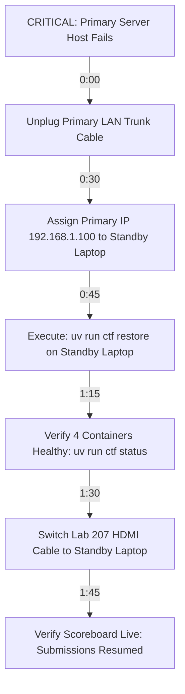

# EVENT.md — Master Event Dossier & Comprehensive Operations Plan
> **Case File: The Mid-Sem Leak** | IEEE AUSB Annual Cybersecurity CTF  
> **Date:** Wednesday, 28 October 2026 | **Time:** 2:00 PM – 6:00 PM IST  
> **Venues:** Computer Labs 207 & 208, AU Campus, Ahmedabad University  
> **Deployment Architecture:** 100% Offline Campus LAN (Port 80) | Standby Failover Target: `< 2 min`  
> **Target Audience:** 20 Teams (40–80 Undergraduate Engineering & Computing Students)  

---

## 1. Executive Summary & Event Premise
**Case File: The Mid-Sem Leak** is an immersive digital forensics Capture The Flag (CTF) competition organized by the **IEEE Ahmedabad University Student Branch (IEEE AUSB)**. Designed as a real-time murder-mystery-style incident triage, the competition challenges 20 undergraduate teams to investigate the illicit exfiltration and circulation of the confidential **OOP 99 (Object Oriented Programming Systems)** mid-semester exam paper authored by **Prof. Hasmukh Chelaiya**.

### Distinctive Pillars:
- **100% Offline LAN Architecture:** The entire CTFd platform, reverse proxy, database, challenge assets, and scoreboards run locally on Gigabit Lab switches on Port 80, completely immune to external internet disruptions.
- **Narrative-Driven Forensic Evidence:** 14 challenges structured across 4 specialized forensic tracks simulating real-world digital triage (network packet streams, Wi-Fi AP association logs, deleted filesystem inodes, stripped Safe Exam Browser binaries, and audio wiretaps).
- **Anti-AI Hardened Puzzles:** Every challenge incorporates multimodal, sensory, volatile, or custom corpus defenses that cannot be solved by generic online Large Language Models.
- **High-Voltage Gamification:** A live big-screen projector dashboard, synchronized audio soundboard, rate-limit intrusion sirens, an interactive 8-segment Spin Wheel, physical Hot Sauce lifelines, a 15-minute vanishing bonus challenge, a 10-minute lightning round, and a climactic 15-minute scoreboard blackout.

---

## 2. Venues, Physical Staging & Network Topology

### A. Laboratory Room Allocations (AU Campus)

```
┌─────────────────────────────────────────────────────────────┐
│                      AU LAB 207 (COMMAND WING)              │
│                                                             │
│   [Ceiling Projector 1] ─── Fullscreen Live Scoreboard      │
│   [Audio/Visual Console] ── 12-Track Live Soundboard + PA   │
│   [Primary Server Desk] ─── Host PC (CTFd Stack Port 80)    │
│   [Hot Sauce Station] ───── Sanitary Lifeline Table         │
│   [Crime Scene Station] ─── Lab 207 Physical Forensics PC   │
│                                                             │
│   Stations 01 – 10: Teams 01 through 10 (2–4 players/team)  │
└──────────────────────────────┬──────────────────────────────┘
                               │ Gigabit Trunk Cable
┌──────────────────────────────┴──────────────────────────────┐
│                    AU LAB 208 (INVESTIGATION WING)          │
│                                                             │
│   [Ceiling Projector 2] ─── Synchronized Scoreboard Feed    │
│   [Standby Server Desk] ─── Hot-Standby Laptop (Live Sync)  │
│   [Floor Mentor Desk] ───── Secondary Volunteer Hub         │
│                                                             │
│   Stations 11 – 20: Teams 11 through 20 (2–4 players/team)  │
└─────────────────────────────────────────────────────────────┘
```

### B. Network Architecture & IP Allocation
- **Physical Network:** Dedicated campus gigabit switches connecting Lab 207 and Lab 208.
- **Subnet Configuration:** `192.168.1.0/24` (or lab designated private subnet).
- **Static IP Reservations:**
  - **Primary Server (CTFd Stack):** `192.168.1.100` (Port 80 HTTP).
  - **Hot-Standby Host:** `192.168.1.101` (Pre-configured to adopt `.100` on failover).
  - **AV Console Station:** `192.168.1.102`.
  - **Crime Scene Workstation:** `192.168.1.105` (Physical Lab 207 PC).
  - **Participant DHCP Pool:** `192.168.1.110` – `192.168.1.190`.
- **Local DNS & Host Aliasing:**
  - Primary URL: `http://192.168.1.100`
  - Fallback local DNS / hosts entry: `http://ctf.local` mapped via local dnsmasq on primary host.
- **Firewall Policy:**
  - Incoming TCP Port 80 allowed from lab subnet.
  - External WAN routing disabled or isolated to ensure pure offline reliability.

---

## 3. Key Personnel & Operational Roster

| Role | Name | Handle / Desk | Operational Domain |
| :--- | :--- | :--- | :--- |
| **Core Event Lead & Emcee** | **Vansh Shah** | Event Stage / Lab 207 | Opening remarks, participant welcome, speaker session coordination, prize distribution. |
| **Co-Tech Lead (Infrastructure)** | **Manas Doshi** | `@moodynooby` (Lab 207) | MariaDB engine, Nginx tuning, CLI operations, blackout trigger, scoreboard reveal. |
| **Co-Tech Lead (Ops & Standby)** | **Krish** | `@Krish-452` (Lab 208) | Hot-standby sync, timed event triggers, scoreboard projector feed, volunteer hints liaison. |
| **Track Lead: Forensics & Stego** | **Yesha** | Reserved (Lab 207) | Audio spectrogram challenge, PDF hidden text, fragmented Base64, physical RAM dump. |
| **Track Lead: Web & AI** | **Tanish Shah** | `@tanishshahh` (Lab 207) | Proctor bot prompt jailbreak, cookie tampering, PHP webshell, AV soundboard operator. |
| **Track Lead: Binary & Crypto** | **Vidit** | `@viditd1-eng` (Lab 208) | Android APK reversing, password hash cracking, Safe Exam Browser reversing, UI theme. |
| **Track Lead: Network & Logs** | **Vatsal Pandya** | `@VP1107` (Lab 208) | Wi-Fi logs auto-sync twist, ransomware PCAP, angry TA emails, Spin Wheel web app operator. |
| **Floor Mentors & Marshals** | **8 IEEE Volunteers** | Labs 207 & 208 (4 per lab)| Check-in verification, network troubleshooting, Hot Sauce safety, flag submission rate-limit alerts. |

---

## 4. Participant Ingress, Kit Distribution & Software Toolkit

### A. Team Onboarding Workflow (2:30 PM – 3:00 PM)
1. **Automated Registration Ingestion:**
   - Registrations from Google Forms are ingested directly into CTFd via `uv run ctf import "Case Files - Registration Form Responses - Form Responses 1.csv"`.
   - Generates `participants_credentials.csv` containing pre-seeded credentials for all teams, captains, and members.
2. **Welcome Desk (Entrance of Lab 207):**
   - Verification of student ID cards and event registration confirmation.
   - Assignment of physical Team Number (Team 01 to Team 20) and Lab Station.
3. **Physical Investigation Kit Distribution:**
   - **Classified Incident Briefing Dossier:** Multi-page printed booklet with suspect dossiers, timeline diagram, floor plans, and notes from Prof. Chelaiya.
   - **Station Credential Card:** Pre-printed badge containing:
     - Team Name & Number.
     - Assigned Station (e.g. `Lab 207 - Station 04`).
     - Pre-seeded CTFd credentials (from `participants_credentials.csv`).
     - Access URL: `http://192.168.1.100`.
   - **Investigator Scratchpad & Pen:** For manual cipher calculations and timeline correlation.

### B. Recommended Participant Software Toolkit
Participants are advised during pre-event communications to have the following tools installed on their laptops:
- **Network Analysis:** Wireshark / TShark.
- **Audio & Signal Analysis:** Audacity or Sonic Visualiser.
- **Reverse Engineering & Disassembly:** Ghidra, IDA Free, or GDB; JADX-GUI (for APK reversing).
- **Forensic Utilities:** The Sleuth Kit (`fls`, `icat`), `foremost`, `binwalk`, `pdftotext`, `strings`.
- **Cryptography & Hash Cracking:** John the Ripper, Hashcat, `zip2john`.
- **Scripting:** Python 3 (with `requests`, `scipy`, `pypdf`, `cryptography` libraries).
- **Offline Utilities:** Standalone offline CyberChef (hosted on CTFd static downloads).

---

## 5. Master Minute-by-Minute Schedule (28 October 2026)

```
02:00 PM ─── Staff Arrival, Server Boot & Network Dry Run
02:30 PM ─── Participant Check-in & Station Seating (Labs 207 & 208)
03:00 PM ─── 🎙️ Expert Talk: Modern Cyber Forensics & Incident Response
04:00 PM ─── 📋 Case Briefing, Canon Lore Presentation & Rules Q&A
04:30 PM ─── 🚀 ACTIVE COMPETITION WINDOW BEGINS (1 Hour)
04:35 PM ─── ⏳ Milestone 1: 15-Minute Vanishing Bonus Challenge Unlocked
04:45 PM ─── 📂 Milestone 2: Intel Clue Drop #1 & Spin Wheel Round 1
04:50 PM ─── 🔒 Milestone 3: Vanishing Bonus Challenge Expires
05:00 PM ─── ⚡ Milestone 4: 10-Minute Lightning Round (2x Points) & Spin Wheel Round 2
05:10 PM ─── ⚡ Milestone 5: Lightning Round Closes & Intel Clue Drop #2
05:15 PM ─── 🌑 Milestone 6: Scoreboard Blackout (Suspense Mode on Projectors)
05:30 PM ─── 🏁 COMPETITION TERMINATION (Submissions Locked)
05:35 PM ─── 🏆 Master Scoreboard Reveal & Fictional Culprit Unmasked
05:45 PM ─── 🎁 Awards Ceremony, Trophies & Closing Vote of Thanks
```

---

## 6. Detailed Phase Breakdown & Spoken Emcee Scripts

### Phase I: Setup, Ingress & Speaker Session (2:00 PM – 4:30 PM)

#### 2:00 PM – 2:30 PM: Infrastructure Boot & Sanity Check
- Manas and Krish power up Primary and Standby hosts.
- Execute `uv run ctf start` and confirm all 4 containers healthy via `uv run ctf status`.
- Execute `uv run ctf theme` to activate the `m0xblood` primary dark theme and inject scoreboard projector styles.
- Connect HDMI feeds to Lab 207 and Lab 208 ceiling projectors; open `http://localhost/scoreboard` in fullscreen (`F11`).
- Run `uv run ctf backup` and test sync to standby laptop: `uv run ctf sync 192.168.1.101`.

#### 2:30 PM – 3:00 PM: Team Ingress & Seating
- Volunteers welcome teams, distribute dossiers and station cards, guide them to assigned stations.
- Verify laptops connect to local Wi-Fi / Ethernet and load `http://192.168.1.100`.

#### 3:00 PM – 4:00 PM: Expert Talk / Technical Guest Session
- **Title:** *"Deconstructing Modern Cyber Forensics: From Incident Triage to Attribution"*.
- **Focus:** Practical digital forensics, inspecting packet flows, memory analysis, steganography principles, and ethical hacking standards.
- While session is underway, Tech Leads verify all 20 team accounts in CTFd and test snapshot synchronization.

#### 4:00 PM – 4:30 PM: Case Briefing & Rules Review
- Organizer Vansh Shah takes the podium in Lab 207 (projected to Lab 208):
  > *"Investigators, welcome to Ahmedabad University. Last night at 21:14 IST, a confidential draft of Prof. Hasmukh Chelaiya's upcoming OOP 99 mid-sem examination was illicitly downloaded and leaked from the faculty share. Department records show high tension and grievances surrounding harsh grading in OS 101. Administration has convened your teams to trace the digital breadcrumbs, analyze the evidence dockets, and unmask the mastermind before the exam paper circulates campus. You have exactly one hour. Good luck!"*
- Rules explained: `case{...}` flag syntax, dynamic scoring formula, 5-fail rate limit policy, Spin Wheel and Hot Sauce lifeline rules.

---

### Phase II: Active Competition Window (4:30 PM – 5:30 PM)

#### 4:30 PM: Competition Commences
- **Action:** Tech Leads unlock challenge visibility in CTFd.
- **Sound Cue:** `01_start_fanfare.mp3` triggers across lab audio.
- **Emcee Script:**
  > *"The investigation is officially live! Your terminals are active. Review your dossiers, access the evidence files at 192.168.1.100, and claim First Blood!"*

#### 4:35 PM: Milestone 1 — 15-Minute Vanishing Bonus Challenge Unlocked
- **CLI Command:** `uv run ctf events --event vanishing_start`
- **Sound Cue:** `02_radar_ping.mp3`
- **System Action:** CTFd notification broadcasts: *"⏳ TIME-SENSITIVE EVIDENCE DETECTED! Temporary cache trace discovered on lab share. Self-destructs at 4:50 PM!"*
- **Emcee Script:**
  > *"Attention investigators! A volatile evidence docket has appeared in CTFd. You have exactly 15 minutes before the memory trace is purged permanently at 4:50 PM!"*

#### 4:45 PM: Milestone 2 — Intel Clue Drop #1 & Spin Wheel Round 1
- **CLI Command:** `uv run ctf events --event clue_drop_1`
- **Sound Cue:** `03_wheel_spin.mp3`
- **System Action:** Clue broadcast: *"Forensics recovered deleted syslog timestamps. Check Act II portal traces."*
- **Gamification:** The live Projector Spin Wheel activates! Teams currently with zero solves or stuck on a challenge can volunteer a teammate to spin the wheel or take a Hot Sauce shot for an unpenalized hint.

#### 4:50 PM: Milestone 3 — Vanishing Bonus Challenge Purged
- **CLI Command:** `uv run ctf events --event vanishing_end`
- **Sound Cue:** `04_evidence_purge.mp3`
- **System Action:** Unsolved vanishing challenge hidden from CTFd view.
- **Emcee Script:**
  > *"The vanishing cache trace has been overwritten. The investigation moves forward!"*

#### 5:00 PM: Milestone 4 — 10-Minute Lightning Round (2x Points) & Spin Wheel Round 2
- **CLI Command:** `uv run ctf events --event lightning_start`
- **Sound Cue:** `05_lightning_alert.mp3`
- **System Action:** CTFd notification: *"⚡ 10-MINUTE LIGHTNING ROUND ACTIVE! Double points awarded for solving within the next 10 minutes!"*
- **Emcee Script:**
  > *"Investigators! The 10-minute Lightning Round has officially started! Double points on the table until 5:10 PM! High-intensity speed run!"*
- Spin Wheel activates for the final round of lifelines.

#### 5:10 PM: Milestone 5 — Lightning Round Closes & Intel Clue Drop #2
- **CLI Command:** `uv run ctf events --event lightning_end` followed by `uv run ctf events --event clue_drop_2`
- **System Action:** Clue broadcast: *"Key derivation function identified. Cross-reference campus dossier names!"*

#### 5:15 PM: Milestone 6 — Scoreboard Blackout (Suspense Mode)
- **CLI Command:** `uv run ctf blackout`
- **Sound Cue:** `06_blackout_glitch.mp3` (heavy power down / electrical glitch sound)
- **System Action:** MariaDB updates config `freeze=true`. Projectors switch to full-screen **'LOCKDOWN ACTIVE — SCOREBOARD FROZEN'** graphic.
- **Emcee Script:**
  > *"The scoreboard is now dark! Public scores are frozen. All solves are registering silently on the backend. You have 15 minutes to crack the final culprit and secure the championship!"*
- Tech Leads monitor backend solves privately; run intermediate backup: `uv run ctf backup`.

#### 5:30 PM: Competition Termination
- **Sound Cue:** `07_times_up_siren.mp3`
- **Action:** Flag submissions locked in CTFd.
- **Emcee Script:**
  > *"Step back from your keyboards! The investigation is officially closed. All submissions are locked!"*

---

### Phase III: Reveal, Awards & Closing Ceremony (5:30 PM – 6:00 PM)

#### 5:35 PM: Live Scoreboard Reveal & Narrative Resolution
- **CLI Command:** `uv run ctf reveal`
- **Sound Cue:** `08_reveal_victory.mp3`
- **Emcee Script:**
  > *"Investigators, the case is solved. At 02:13 AM, Prof. Chelaiya's ThinkPad auto-synced the draft exam over the faculty AP. But it wasn't a student hack—it was TA Piyush Pelaiya, seeking revenge for his failing grade in OS 101! And now, let us reveal the final standings!"*
- Public scoreboard unfreezes; displays 20th place through 1st place in reverse order on the lab projectors.

#### 5:45 PM – 6:00 PM: Prize Distribution & Awards Ceremony
- Awarding of trophies, medals, vouchers, and certificates.
- Closing remarks by Faculty Mentor and IEEE AUSB Chairperson.
- Group photograph of all 20 teams in Lab 207.

---

## 7. Interactive Gamification Mechanics & Protocols

### A. The Big-Screen Projector Spin Wheel
- **Software Architecture:** Standalone offline HTML5 Canvas + TailwindCSS app running on `192.168.1.102` (`tools/spin_wheel/index.html`).
- **Display Mode:** Fullscreen on 1080p projectors with high-contrast glowing segment borders and neon ticker needle.
- **Controls:** `Space` = Trigger Spin; `R` = Reset to initial state; `M` = Toggle Mute.

#### Segment Probability & Distribution Table

| Segment Name | Probability Weight | Visual Icon | In-Game Effect | Risk / Reward Level |
| :--- | :---: | :---: | :--- | :--- |
| **Hot Sauce Shot** | 20% | 🌶️ | Teammate eats 1 spoonful of hot sauce $\rightarrow$ 1 free hint awarded without point penalty. | High Physical / High Reward |
| **Public Intel Drop** | 15% | 💡 | Host announces a global 1-sentence clue on the projector screen for all teams. | Neutral / Cooperative |
| **5-Min Speed Window** | 15% | ⚡ | If the spinning team solves any challenge in the next 5 mins, they receive +50 bonus points. | High Urgency Reward |
| **2-Min Keyboard Freeze** | 10% | 🛑 | The entire spinning team must step back from computers for 120 seconds. | Mild Penalty |
| **Eliminate a Decoy** | 15% | 🎭 | Host publicly eliminates one innocent suspect profile from the case board. | Pure Benefit |
| **Teammate Role Swap** | 10% | 🔄 | Teammates must swap seats and workstations for the next 10 minutes. | Chaotic Fun |
| **Sweet Relief** | 10% | 🍬 | A bowl of chocolates/candy delivered to the team's workstation. | Morale Booster |
| **Sound the Alarm** | 5% | 🚨 | Lab PA system sounds an intrusion alarm for 5 seconds. | Atmospheric Chaos |

### B. Hot Sauce Lifelines Protocol & Safety Standards
1. **Sanitary Station:** Set up at the front of Lab 207. Equipped with nitrile gloves, disposable single-use wooden spoons, napkins, water cups, and whole milk / yogurt for immediate cooling.
2. **Sauce Specification:** Certified commercial mild-to-medium hot sauce (approx. 5,000–10,000 Scoville Heat Units, e.g. Sriracha or mild Tabasco). Completely food-safe.
3. **Allergy & Medical Screening:** Purely voluntary opt-in. Participants with gastric sensitivity, spice intolerance, or allergies are provided with ultra-sour candy or spicy wasabi peas as safe alternatives.
4. **Hint Delivery:** Upon verified consumption by an IEEE volunteer marshal, the Tech Lead enters the team's number into CTFd admin and unlocks their requested hint docket with zero score deduction.

### C. Intrusion Punishments & Siren Alerts (Anti-Bruteforce)
- **Automatic Trigger:** If any team submits **5 consecutive incorrect flags**, CTFd enforces an automatic 60-second submission lockout.
- **AV Reaction:** The projector flashes an intrusion warning banner (`INTRUSION DETECTED: STATION COOLDOWN ACTIVE`) accompanied by a short 3-second audio buzzer.

---

## 8. Scoring System, Tie-Breakers & Prize Structure

### A. Dynamic Scoring Engine
- **Initial Challenge Value:** 500 Points.
- **Decay Parameter:** 15 Solves (points decrease smoothly with each solve).
- **Minimum Value Floor:** 100 Points.
- **Decay Formula:**
  $$\text{Points} = \max\left(100, \text{Round}\left(\left(\frac{100 - 500}{(15)^2}\right) \times (\text{Solves} - 1)^2 + 500\right)\right)$$

### B. Tie-Breaking Hierarchy
1. **Primary:** Total Accumulated Points.
2. **Secondary (Timestamp):** Earliest submission timestamp of the team's final scoring flag.
3. **Tertiary (Accuracy):** Fewest total incorrect flag submissions.

### C. Official Prize Categories
1. **🏆 The Grand Forensic Champion (1st Place):**
   - Official IEEE AUSB CTF Championship Trophy
   - Winner Vouchers / Cash Prize
   - Certificates of Distinction
   - Exclusive IEEE Cyber Swag Kits
2. **🥈 Lead Forensic Specialist (2nd Place):**
   - Silver Runner-Up Trophy & Medals
   - Runner-up Vouchers & Swag
   - Certificates of Distinction
3. **🥉 Incident Response Finalist (3rd Place):**
   - Bronze 2nd Runner-Up Trophy & Medals
   - Finalist Vouchers & Swag
   - Certificates of Distinction
4. **🩸 First Blood Slayer Award:**
   - Special custom certificate + prize for the team securing the highest count of first-blood solves across all 14 challenges.
5. **📜 Certificate of Investigation:**
   - Issued to every participating student verifying completion of the IEEE AUSB Forensic Triage challenge.

---

## 9. Comprehensive Disaster Recovery & Emergency Failover

### Emergency Failover Playbook (RTO `< 120 Seconds`)



### Risk & Failure Matrix

| Failure Mode | Impact | Immediate Mitigation Action | Responsible Lead |
| :--- | :--- | :--- | :--- |
| **Primary Host Power Loss** | Total server drop | Hot-switch to Standby Laptop via `uv run ctf restore`. | Manas & Krish |
| **Gigabit Switch Failure** | Disconnects Lab 208 | Swap to pre-staged spare 16-port Gigabit switch in Lab 207. | Vansh Shah |
| **Projector HDMI Disconnect**| Big-screen display loss | Switch projector source to secondary AV laptop; reload scoreboard URL. | Tanish Shah |
| **MariaDB Lock / Crash** | 500 errors on CTFd | Run `uv run ctf stop && uv run ctf start`; named volumes preserve DB. | Manas Doshi |
| **Participant LAN IP Conflict**| Network unreachable | Assign static IP from reserved pool `192.168.1.191–199`. | Floor Volunteers |
| **Team Submits 50+ Spam Flags**| Server load spike | Floor volunteer warns team; temporary 5-min IP block in Nginx if malicious. | Co-Tech Leads |

---

## 10. Emergency Contacts & Escalation Tree

| Contact | Primary Station | Role & Escalation Authority | Phone / Radio |
| :--- | :--- | :--- | :--- |
| **Vansh Shah** | Lab 207 Podium | Core Organizer (Logistics, Venue & Faculty Disputes) | Desk Phone / Ch 1 |
| **Manas Doshi** | Lab 207 Server Desk | Co-Tech Lead (Primary Infrastructure & Database) | Desk Phone / Ch 1 |
| **Krish** | Lab 208 Standby Desk| Co-Tech Lead (Standby Host & Live Automation) | Desk Phone / Ch 2 |
| **AU Lab In-charge** | AU Facilities 1st Fl| Electrical Power, Air Conditioning & Hardware Switches| Ext. 2071 |
