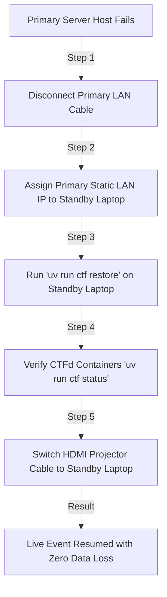

# HANDOFF.md — Engineering & Operations Handoff Document
> **Case File: The Mid-Sem Leak** | IEEE AUSB CTF (28 Oct 2026, AU Labs 207 & 208)  
> **Tech Leads:** Manas Doshi (@moodynooby) & Krish (@Krish-452) | **Core Organizer:** Vansh Shah  
> **Active Contributors:** Vidit (@viditd1-eng), Tanish (@tanishshahh), Vatsal (@VP1107), Yesha  

---

## 1. Executive Summary & Current State of the Codebase
This repository contains the complete offline-first containerized infrastructure, challenge scaffolding, live operational automation, and participant kit for **Case File: The Mid-Sem Leak**.

### Key Facts & Deployment Specs:
- **Event Date:** Wednesday, 28 October 2026 (Active Window: 4:30 PM – 5:30 PM IST).
- **Target Audience:** 20 teams (40–80 undergraduate students).
- **Core Engine:** Pinned CTFd 3.7.0 with MariaDB 10.11, Redis 7-Alpine, and custom tuned Nginx proxy on Port 80.
- **Unified Tooling:** Single cross-platform CLI runner powered by `uv`: `uv run ctf <command>`.
- **Zero Cloud LAN:** Engineered to operate completely disconnected from external internet on AU Lab switches.
- **Failover Target:** Standby laptop synchronization mechanism with `< 2-minute` Recovery Time Objective (RTO).

---

## 2. Infrastructure & Architectural Blueprint

```
                     [ Campus LAN Switch (Port 80) ]
                                    │
                                    ▼
       ┌────────────────────────────────────────────────────────┐
       │             Nginx Reverse Proxy (conf/nginx/)          │
       │    - Port 80 binding (HTTP)                            │
       │    - SSE proxy buffering disabled (/events -> CTFd)    │
       │    - Static evidence files (/files/ -> /var/uploads/)  │
       │    - Big-screen AV Console (/av-console/)              │
       │    - App traffic routed through Anubis PoW proxy       │
       └────────────────────────────┬───────────────────────────┘
                                    │
                                    ▼
       ┌────────────────────────────────────────────────────────┐
       │           Anubis Anti-Bot / Anti-AI Proxy              │
       │    - ghcr.io/techarohq/anubis (Port 8080)              │
       │    - Proof-of-Work (PoW Difficulty 3) Challenge        │
       │    - Denies automated AI scrapers and aggressive bots   │
       └────────────────────────────┬───────────────────────────┘
                                    │
                  ┌─────────────────┴─────────────────┐
                  ▼                                   ▼
       ┌────────────────────────┐          ┌───────────────────────┐
       │   CTFd Application     │          │  MariaDB 10.11 Engine │
       │   - Version 3.7.0      │          │  - 250 Max Conns      │
       │   - Dynamic Scoring    │◄────────►│  - UTF8MB4 Collation  │
       │   - Session Engine     │          │  - InnoDB Buffer Pool │
       └──────────┬─────────────┘          └───────────────────────┘
                  │
                  ▼
       ┌────────────────────────┐
       │  Redis 7 Cache Layer   │
       │  - Ephemeral Sessions  │
       │  - Dynamic Rate Limits │
       └────────────────────────┘
```

### Critical Volume & Persistence Quirks
1. **Database & Uploads Storage:**
   - MariaDB tables (`ctfd_db`) and file assets (`ctfd_data` at `/var/uploads`) reside in named Docker volumes.
   - `uv run ctf stop` preserves all volumes safely.
   - **WARNING:** Running `docker compose down -v` or `docker volume prune` **will permanently destroy all team accounts, theme configs, and custom markdown pages**. Always run `uv run ctf backup` before touching volume states.
2. **Theme Mounts:**
   - Custom Jinja2 themes and stylesheets are mounted declaratively via [docker-compose.yml](docker-compose.yml) (`./themes/m0xblood:/opt/CTFd/CTFd/themes/m0xblood:ro`).
   - Running `uv run ctf theme` automatically activates `m0xblood` as the primary CTFd theme via the REST API and injects big-screen scoreboard styling into `theme_header`/`theme_footer`. Never manually alter files inside the running container.
3. **Anubis Cookies Must Not Be `Secure` (Plain HTTP on Port 80):**
   - Anubis `v1.28+` defaults to `cookie-secure=true` and `cookie-partitioned=true`. Over `http://` browsers silently drop those cookies, so the verification cookie never returns and every participant loops on `user has cookies disabled` (`docker logs ctfd_anubis` confirms) — only `http://localhost` works, which wrongly suggests a per-machine issue.
   - [docker-compose.yml](docker-compose.yml) pins `COOKIE_SECURE=false` and `COOKIE_PARTITIONED=false` on the `anubis` service. `SameSite=None` auto-downgrades to `Lax` once `COOKIE_SECURE=false`.
   - Verify with `curl -sD- -o /dev/null http://<LAN-IP>/ | grep -i set-cookie` (must have **no** `Secure`/`Partitioned`) and `python3 ops/anubis_pow_check.py http://<LAN-IP>` (`RESULT: PASS`).
4. **Seeded Challenges Must Set `max_attempts` (else every challenge click 500s):**
   - CTFd defaults `challenges.max_attempts` only in the ORM (`default=0`), so a raw-SQL seed that omits the column stores `NULL`. `core-beta/challenge.html` evaluates `` and throws `TypeError` → `/api/v1/challenges/<id>` returns **500**, and the browser shows `can't access property "type_data", r is undefined` in `loadChallenge(c.id)`. The board renders, but no challenge opens.
   - [ops/seed_challenges.py](ops/seed_challenges.py) now writes `max_attempts` explicitly on insert/update, repairs pre-existing `NULL` rows, and exits non-zero if any remain. Re-run `uv run ctf seed` after pulling; it is idempotent.
   - Post-seed smoke test: logged-in `GET /api/v1/challenges/<id>` must return `200 application/json` containing a `view` key. `[SUCCESS]` in the seeder banner alone is not sufficient evidence.
5. **Seeded Attachments Must Be `files.type='challenge'`:**
   - `Files` uses SQLAlchemy single-table inheritance: only `type='challenge'` rows instantiate `ChallengeFiles`, and `Challenges.files` joins nothing else. Files seeded as `type='standard'` are downloadable at `/files/<sha1>/<name>` but produce **no download links** in the challenge modal.
   - [ops/seed_challenges.py](ops/seed_challenges.py) writes `type='challenge'`, back-fills existing rows, and fails the run if any challenge attachment is mistyped. Smoke test: the challenge's API `data.files` array must be non-empty and the modal `view` HTML must contain `/files/` hrefs.
6. **Regenerated Artifacts Must Replace, Not Append (stale PDF trap):**
   - CTFd stores uploads at `/var/uploads/<sha1>/<filename>`, so **any** content change produces a new location. The original seeder only ever INSERTed (`SELECT … WHERE location = …` → miss → INSERT), so a regenerated PDF/EML added a *second* identically-named attachment and left the old row live: the modal advertised the stale file first, and `/files/<old_sha1>/<name>` kept serving the old bytes forever.
   - [ops/seed_challenges.py](ops/seed_challenges.py) now runs `sync_challenge_files()`: it computes the expected `sha1/filename` set from the YAML `files:` block, `DELETE`s every row for that challenge outside the set, removes the orphaned `/var/uploads/<sha1>/` blob **only if no other row references it**, then uploads. Re-seeding is therefore declarative — edit an artifact, run `uv run ctf seed`, and the live download matches disk.
   - Smoke test: `SELECT challenge_id, location FROM files` must return exactly one row per YAML `files:` entry, and `sha1sum` of the DB location's basename inside `ctfd_app` must equal `sha1sum` on disk.

---

## 3. Hosted Challenge Services (Web & AI Track)

Three challenges are live web services built from source and healthchecked by Compose:

| Container | Port | Directory | Notes |
| :--- | :---: | :--- | :--- |
| `challenge_cookie_api` | `5001` | `challenges/cookie_api/` | Cookie elevation + unlisted REST endpoint; decoy at `/api/v1/admin/secret` |
| `challenge_proctor_bot` | `5002` | `challenges/ai_prompt_injection/` | Bridge container → host Ollama via `host.docker.internal` |
| `challenge_php2shell` | `5003` | `challenges/php2shell/` | Polyglot upload → simulated PHP execution |

**Invariants:**
- **php2shell isolation:** every upload is stored as `<uuid6>_<name>` and **only** that exact link resolves. There is no un-prefixed `/uploads/<name>` fallback — it let concurrent teams overwrite or resolve each other's shells. `solve.py` asserts both the 404 fallback and two same-name uploads staying distinct.
- **Resource guards:** php2shell rejects bodies over 2 MiB (`413`) before buffering and prunes its upload directory to the 500 newest files; the proctor bot caps prompts at 16 KiB. All three raise the listen backlog to 128 and set a socket timeout so slowloris cannot pin threads.
- **Cookie rendering:** `role` / `access_tier` cookie values are `html.escape`d before interpolation (reflected-XSS guard). The vault decoy is registered in [conf/gamification.json](conf/gamification.json) so submitting it fires the siren.
- **Ollama bind (required for the real LLM path):** the proctor bot is a normal `proxy_net` container, so it reaches the host through the docker0 gateway. Ollama must listen on the bridge, not loopback — install [conf/ollama/override.conf](conf/ollama/override.conf) as a systemd drop-in (`OLLAMA_HOST=172.17.0.1:11434`) and restart Ollama. Before that change the bot serves its deterministic regex fallback (still solvable, but not model-backed).
- **Verification:** `uv run ctf status` prints the service health table, probes 5001/5002/5003, and warns when Ollama is loopback-only. `uv run python challenges/<svc>/solve.py http://127.0.0.1:<port>` must exit 0.

---

## 4. Challenge Track Matrix & Status (15 Challenges + Live Ops)

| Issue # | Challenge Name | Category | Difficulty | Assignee | Target Directory | Status |
| :---: | :--- | :--- | :---: | :--- | :--- | :---: |
| **#9** | Liam's Idea: Fragmented Exfiltration | Forensics | Easy | Yesha | `challenges/fragmented_exfiltration/` | Completed (Verified) |
| **#10** | PDF Hidden Text: The Redacted Exam Paper | Forensics | Easy | Yesha | `challenges/pdf_hidden_text/` | Completed (Verified) |
| **#11** | Audio Spectrogram: Lab Microphone Wiretap | Stego | Medium | Yesha | `challenges/audio_spectrogram/` | Completed (Verified) |
| **#12** | Physical Forensics: Lab 207 Terminal RAM Dump | Forensics | Medium | Yesha | `challenges/physical_terminal_ram/` | Completed (Verified) |
| **#13** | Cookie / API: Faculty Exam Vault | Web | Easy | @tanishshahh | `challenges/cookie_api/` | Completed (Verified) |
| **#14** | AI Model Prompt: Proctor Bot Jailbreak | AI | Medium | @tanishshahh | `challenges/ai_prompt_injection/` | Completed (Verified - SmolLM2 Local LLM) |
| **#15** | PHP2SHELL: Faculty Upload Bypass | Web | Hard | @tanishshahh | `challenges/php2shell/` | Completed (Verified - Multi-Team Isolated) |
| **#16** | Intrusion Punishments & Siren Alerts | Live Ops | — | @tanishshahh | `ops/siren_alert/` | Completed (Verified - Decoy Monitor & AV Siren) |
| **#17** | APK Reverse Engineer: Suspect's App | Reversing | Medium | @viditd1-eng | `challenges/apk_companion_reversing/` | Completed (Verified) |
| **#18** | Password Cracking: Faculty Vault | Crypto | Hard | @viditd1-eng | `challenges/password_cracking/` | Completed (Verified) |
| **#31** | Safe Exam Browser (SEB) Reversing | Reversing | Hard | @C00LVansh | `challenges/seb_binary/` | Completed (Verified — PE64 binary-patched, solve.py exit 0) |
| **#20** | DNS / Wi-Fi Logs: 2:13 AM Auto-Sync | Network | Medium | @VP1107 | `challenges/wifi_dns_logs/` | Completed (Verified) |
| **#21** | Ransomware Infected: Web Shell PCAP | Network | Medium | @VP1107 | `challenges/ransomware_pcap/` | Completed (Verified) |
| **#22** | Deleted but Not Gone: Erased Exam Draft | Forensics | Easy | @VP1107 | `challenges/deleted_evidence/` | Completed (Verified) |
| **#23** | Flag in Cheatsheet: Participant Kit Egg | Forensics | Easy | @VP1107 | `challenges/cheatsheet_egg/` | Completed (Verified) |
| **#24** | Email Forensics: Angry TA's Leaked Mails| Forensics | Medium | @VP1107 | `challenges/email_forensics/` | Completed (Verified) |
| **#25** | Projector Spin Wheel & Hot Sauce App | Live Ops | — | @VP1107, @tanishshahh | `tools/spin_wheel/` | Completed (Verified - Canvas & Web Audio) |
| **#1** | CTFd Theme: Cyber-Forensic Dark Mode | UI/UX | — | @viditd1-eng | `themes/midsem_leak/` | In Flight |
| **#2** | Big-Screen Projector & Sound Cue Board | AV/Ops | — | @tanishshahh | `ops/soundboard/` | In Flight |
| **#4** | Case Dossier Print Kit & Slide Deck | Design | — | Open | `docs/participant_kit/` | In Flight |

**Scoring weight (live, verified via `uv run ctf seed`):** the `Difficulty` column above is not cosmetic — it is declared as `difficulty:` in each `challenge.yml` and drives a dynamic-scoring band: **Easy 300 → 100**, **Medium 500 → 200**, **Hard 700 → 350**. Max board total is **7,100 pts** (5 easy, 7 medium, 3 hard). Full matrix in [challenges/README.md](challenges/README.md#3-difficulty-tiered-dynamic-scoring) and [EVENT.md](EVENT.md#8-scoring-system-tie-breakers--prize-structure).

---

## 5. Canon Storyline & Lore Blueprint

### The Core Incident
- **The Victim:** **Prof. ManMishra Chelaiya** (Faculty teaching **OS 101** and author of the leaked **OOP 99** Mid-Sem Exam).
- **The Culprit:** **TA Piyush Pelaiya** (Graduate teaching assistant who received failing/unfair grades from Prof. Chelaiya in OS 101, prompting a revenge-driven exfiltration of the OOP 99 exam paper).
- **The Decoys & Framed Students:**
  - *Sansh Vhah* (`@binary_breeze`): Lab 208 check-in decoy.
  - *Danas Moshi* (`@ghost_in_the_lab`): Terminal footprint decoy.
  - *Prish Koddar* (`@root_ninja`): Active VPN session decoy.
  - *Tryan Ahakkar* (`@cipher_sid`): Student Lounge Wi-Fi decoy.
  - *Parsh Hatel* (`@data_drifter`): Seminar Hall club meeting decoy.
- **The Master Plot Twist (Challenge #20):**
  - Wi-Fi logs indicate that at **02:13:42 IST**, device `prof_chelaiya_thinkpad_x1` synced the mid-sem draft to a shared directory, which TA Piyush hijacked via an unprotected session!

---

## 6. Operations & Unified CLI Cheat Sheet (`uv run ctf`)

All tasks must be invoked via `ctf.py`:

```bash
# === LIFECYCLE COMMANDS ===
uv run ctf start          # Spin up Nginx, CTFd, MariaDB, Redis; prints LAN IP
uv run ctf status         # Verify health status of all 4 containers
uv run ctf stop           # Clean shutdown preserving Docker volumes

# === BACKUP, DISASTER RECOVERY & STANDBY SYNC ===
uv run ctf backup         # Dump DB + uploads into backups/ctfd_backup_<timestamp>.tar.gz
uv run ctf sync <IP>      # Push backup archive to secondary laptop over LAN (SCP/SSH)
uv run ctf restore        # Restore DB and uploads from latest backup archive

# === LIVE EVENT MILESTONES (28 OCT) ===
uv run ctf events                    # Open interactive CLI control panel
uv run ctf events --event vanishing_start   # 4:35 PM: Release 15-min bonus challenge
uv run ctf events --event clue_drop_1       # 4:45 PM: Broadcast Intel Clue #1
uv run ctf events --event vanishing_end     # 4:50 PM: Hide vanishing challenge
uv run ctf events --event lightning_start   # 5:00 PM: Unlock 10-min Lightning Round (2x pts)
uv run ctf events --event lightning_end     # 5:10 PM: Lock Lightning Round
uv run ctf events --event clue_drop_2       # 5:10 PM: Broadcast Intel Clue #2
uv run ctf blackout                         # 5:15 PM: Freeze scoreboard into suspense mode
uv run ctf reveal                           # 5:30 PM: Unfreeze scoreboard for ceremony
uv run ctf theme                            # Apply m0xblood theme and scoreboard projector styling
uv run ctf seed                             # Seed all challenges, flags, attachments into CTFd
uv run ctf import [CSV]                     # Ingest registration form CSV & generate credentials dossier
uv run ctf setup                            # One-shot stack bootstrap, challenge seeder & bindings
```

---

## 7. Hot-Standby Failover Protocol (Recovery in `< 2 Minutes`)

In the event of total hardware, power, or kernel failure on the Primary Server:



**What the snapshot does and does not carry:**
- `uv run ctf sync` / `backup` bundle **only** `database.sql` + `/var/uploads`.
- The standby needs the git clone and built challenge images (Compose rebuilds them from `challenges/*/Dockerfile`), which are not in the archive.
- **The SmolLM2 model is not in the archive.** `uv run ctf restore` now calls `ensure_ollama()` and falls back to the regex heuristics if the model or daemon is missing — the AI challenge stays solvable, but not model-backed. Pre-pull the model on the standby during setup.
- **php2shell uploaded shells are not in the archive.** Teams must re-upload after failover; their isolated links will 404 until they do.

---

## 8. Immediate Priority Punchlist (Before 27 Oct Dry Run)

1. **Challenge Scaffolding Completion:**
   - Ensure every challenge directory contains `challenge.yml`, `README.md` (solution), `generate.py` / `Dockerfile`, and `solve.py`.
2. **Anti-AI Quality Assurance:**
   - Execute the 5-step verification protocol for all 15 challenges.
   - Run prompt-injection solver against Issue #14 (`proctor_bot.py`) to confirm honeyflag triggering.
   - Check audio spectrogram visualization in Audacity/Sonic Visualiser for Issue #11.
3. **Live Gamification Staging:**
   - Stand up the HTML5 canvas Spin Wheel in `tools/spin_wheel/` (Issue #25).
   - Test audio soundboard cues on Lab 207 & 208 speakers (Issue #2).
4. **Print Asset Verification:**
   - Export printable PDF for `Case_Briefing_Dossier.md` and team scratchcards (Issue #4).
5. **Dry Run in Lab 207/208 (27 Oct 2026):**
   - Test LAN switch port forwarding, IP allocation, projector HDMI resolution, and failover restore.

---

## 9. Governance & Contribution Rules
- **Mandatory Context Reading & Updates:** Every contributor and agent MUST read all operational context docs ([AGENTS.md](AGENTS.md), [EVENT.md](EVENT.md), [HANDOFF.md](HANDOFF.md), [NOTES.md](NOTES.md), [README.md](README.md), [challenges/README.md](challenges/README.md), and [docs/TECH_LEAD_RUNBOOK.md](docs/TECH_LEAD_RUNBOOK.md)) before taking action, and synchronously update all corresponding context docs whenever modifications are made.
- Always refer to [AGENTS.md](AGENTS.md) for strict rules regarding AI contributions (`Assisted-by` attribution), secret hygiene, dynamic scoring formulas, and DCO restrictions (no `Signed-off-by`).
- Keep `.env.example` strictly synchronized with `.env`.
- Link all PRs and commits to relevant issue IDs (`Fixes: #<id>`).
