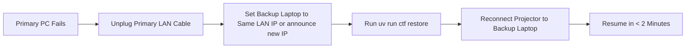

# Tech Lead Runbook & Operational Playbook
## Case File: The Mid-Sem Leak — IEEE AUSB
**Tech Lead Team:** Manas (@moodynooby) & Krish (@Krish-452)  
**Event Date:** 28 October 2026 (Competition 4:30–5:30 PM)  
**Venues:** Computer Labs 207 & 208, GICT

---

## 1. Responsibilities Overview
As the Tech Leads, your duties are:
1. Maintain continuous uptime of the CTFd server instance on the Lab PC / Primary Laptop.
2. Ensure the standby backup laptop has an identical synchronized state and is ready for hot-switch in <2 minutes.
3. Manage the live scoreboard projection on the lab screen.
4. Assist volunteers and teams with local network connectivity or login issues.
5. Trigger timed moments:
   - **4:35 PM:** 15-Minute Vanishing Challenge release.
   - **4:45 PM:** Clue Drop #1 broadcast.
   - **4:50 PM:** Vanishing Challenge expiration / hide.
   - **5:00 PM:** 10-Minute Lightning Round activation (double points).
   - **5:10 PM:** Lightning Round expiration & Clue Drop #2 broadcast.
   - **5:15 PM:** Scoreboard Blackout trigger (Suspense mode).
   - **5:30 PM:** Scoreboard Reveal for the closing ceremony.

---

## 2. Pre-Event Dry Run: 27 October 2026

Complete this dry run inside Lab 207/208 on the day before the event:

### Step 1: Network & IP Setup
1. Connect the Primary Server PC to the Lab switch/Wi-Fi.
2. Check your LAN IP:
   ```bash
   ip -4 addr show
   ```
   *Note the IP (e.g., `192.168.1.100`). Verify with lab admin if a static DHCP reservation is possible.*
3. Verify firewall permits incoming port 80:
   ```bash
   sudo ufw allow 80/tcp
   ```

### Step 2: Start CTFd Stack
```bash
cd ~/Desktop/MID_SEM_LEAK_CTF
uv run ctf start
```

### Step 3: Test from a Secondary Device
1. Open a laptop connected to the same Lab Wi-Fi / LAN.
2. Browse to `http://<PRIMARY_LAN_IP>`.
3. Confirm instant page loading and smooth response.

### Step 4: Configure CTFd Initial Wizard
1. Set CTF Title: **Case File: The Mid-Sem Leak**
2. Mode: **Teams**
3. Create Admin account (Keep credentials in your private password manager).
4. Go to **Profile -> Access Tokens -> Generate Token**.
5. Paste this token into `.env` under `CTFD_ADMIN_TOKEN`.

### Step 5: Test Backup & Standby Laptop
1. Run `uv run ctf backup` on the primary PC.
2. Run `uv run ctf sync <BACKUP_IP>` or copy the `.tar.gz` to the backup laptop via USB.
3. Run `uv run ctf restore` on the backup laptop and confirm CTFd loads with all data intact.

---

## 3. Event Day Minute-by-Minute Timeline (28 October)

| Time | Stage | Action / Commands | Responsible |
| :--- | :--- | :--- | :--- |
| **2:00 PM** | Lab Arrival | Power on Primary PC & Backup Laptop. Connect both to LAN. | Tech Team |
| **2:15 PM** | Server Startup | `uv run ctf start`. Note LAN IP. | Manas / Krish |
| **2:30 PM** | Teams Arrive | Hand LAN URL (`http://<IP>`) to Host & Floor Volunteers. | Tech Team |
| **2:45 PM** | Projector Setup | Connect display to Projector. Open `/scoreboard`. Fullscreen (`F11`). | Krish |
| **3:00 - 4:00 PM** | Expert Talk | Monitor server load. Run `uv run ctf backup` once teams finish creating accounts. | Tech Team |
| **4:00 - 4:30 PM** | Briefing & Rules | Verify all 20 teams can log in and see Act I challenges. | Volunteers / Tech |
| **4:30 PM** | **COMPETITION START** | Announce competition live! Verify live solves stream on scoreboard. | Host & Tech Team |
| **4:35 PM** | **Vanishing Clue** | Run `uv run ctf events --event vanishing_start` | Krish |
| **4:45 PM** | **Clue Drop #1** | Run `uv run ctf events --event clue_drop_1` | Manas |
| **4:50 PM** | **Vanishing Clue Closes**| Run `uv run ctf events --event vanishing_end` | Krish |
| **5:00 PM** | **Lightning Round** | Run `uv run ctf events --event lightning_start` | Krish |
| **5:10 PM** | **Lightning Ends & Clue #2**| Run `uv run ctf events --event lightning_end` then `--event clue_drop_2` | Krish |
| **5:15 PM** | **Scoreboard Blackout** | Run `uv run ctf blackout`. Scoreboard freezes on projector! | Manas |
| **5:15 - 5:30 PM**| Final 15 Mins | Watch backend solves for First Blood on the Final Culprit flag. Run `uv run ctf backup`. | Tech Team |
| **5:30 PM** | **COMPETITION END** | Competition closes. Prepare final rankings. | Tech Team |
| **5:35 PM** | **Scoreboard Reveal** | Run `uv run ctf reveal`. Final scores displayed! | Host & Tech Team |
| **5:40 - 6:00 PM**| Awards Ceremony | Export CTFd CSV data for official event records. | Krish & Manas |

---

## 4. Emergency Contingency: Switching to Backup Laptop

If the Primary PC experiences hardware failure, power loss, or OS freeze:



1. **Step 1:** Disconnect the Primary PC from the LAN cable / Wi-Fi.
2. **Step 2:** On the Backup Laptop:
   ```bash
   cd ~/Desktop/MID_SEM_LEAK_CTF
   uv run ctf restore
   ```
3. **Step 3:** If the backup laptop has a different IP, tell the Host to announce the new IP or point the projector to the new scoreboard URL.
4. **Step 4:** Less than 2 minutes of downtime, zero data lost!
